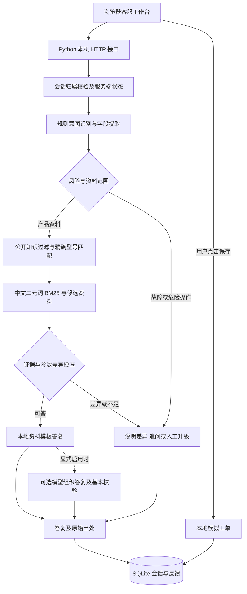

# 迈特威客服 AI Agent 开发思路与实现方案

本方案以迈特威智能设备（广东）有限公司为业务示例，将工作区产品画册中的设备知识，与商业计划书中的“限定岗位、资料可追溯、缺少依据时升级、企业负责知识审核”等要求结合。已交付一个可以本地运行的客服框架，先验证咨询和服务流程，再接入真实企业知识与系统。资料检索与核对日期为 2026 年 11 月 20 日。

当前最合适的首期范围是**产品资料咨询、初步需求收集、售后问题登记**。真实的维修辅助查询需要企业另外提供操作手册、报警表、SOP 和闭环维修记录；仅靠宣传画册不能建立可靠的故障诊断助手。

## 一 先把业务目标和资料边界确认清楚

### 两份文件分别提供什么

| 输入 | 已读内容与作用 | 对知识库的处理 |
| --- | --- | --- |
| `2026 迈特威画册.pdf` | 共 23 个 PDF 物理页，采用双页展开排版；包括企业、产品、整线、客户案例与服务布局 | 扫描件没有可提取文本层；已逐页视觉核对，核心产品条目人工转录，保留 PDF 页与印刷页；尚未建设全量 OCR 管线 |
| `企业专属AI助手商业计划书.docx` | 已提取全文，约 539 个 Word 段落节点；关注设备维护资料检索、RAG、引用、权限、人工升级、校企职责和试点验证 | 作为需求和治理输入；不作为面向客户的设备知识，不进入对客索引及可选模型上下文 |

迈特威的具体业务背景、产品列表和来源核对见 [公司与资料核对](公司与资料核对.md)。公开官网介绍企业成立于 2015 年，总部位于东莞，主营套袋、折盒及后道包装自动化。该主体与天津同名包装机械企业应分开处理。[官网公司简介](https://www.miteway.com/32/)

### 用户与可验证任务

| 用户 | 首期任务 | 助手应产生的结果 |
| --- | --- | --- |
| 潜在客户 | 想了解某设备、找候选机型、询问包装整线 | 带出处的产品答复、候选设备及尚需确认的规格 |
| 已购设备客户 | 报警、维护资料查询、需要售后协助 | 收集型号、序列号、报警和现象；缺资料则进入人工处理 |
| 企业客服 | 重复答复、收集需求、分派问题 | 可回放会话、结构化需求和真实工单接入后的待办 |
| 设备工程师与知识负责人 | 核对技术资料、维护知识 | 待审核条目、来源差异、知识缺口与回归问题 |

第一轮诊断应确认“问题是否高频、资料是否可用、查询是否耗时、谁能复核、如何联系人工”。不预先承诺节省多少人力、降低多少成本或提高多少准确率。

## 二 将 Agent 设计成可以控制的服务工作流

本项目不需要先实现可以任意行动的自主代理。客服任务具有明确分支：能回答的查证答复，缺字段的追问，缺知识或需要决策的交人工。开发者应让工作流掌握权限、状态和工具调用，把模型用于语言理解与资料组织。

### 当前已经实现的架构



默认运行中没有调用向量模型或生成模型。检索是 BM25、中文字符二元词、简单同义词扩展及完整型号匹配；答复由受控分支和知识记录组织。这样可以在没有密钥、没有外发资料的条件下验证工作流。

`agent/llm.py` 提供可选 Chat Completions 兼容接口。只有显式启用且属于可回答的产品资料分支时才调用。报警、危险操作、证据缺失和参数冲突由服务端直接处理。连接器尚未通过真实服务商密钥验证，其格式校验和数字检查也不能证明所有语义都正确。

### 进入企业试点的推荐架构

| 层次 | 建议实现 | 关键责任 |
| --- | --- | --- |
| 渠道层 | 企业网站或企业现有客服入口；后续再扩展企微等渠道 | 统一会话标识，不在前端存放模型密钥 |
| 服务与身份 | FastAPI 等生产服务框架、SSO／企业账号、限流及权限 | 验证租户、用户、岗位、设备与资料授权 |
| 对话编排 | 明确状态机；复杂分支可用 LangGraph | 管理追问、重试、超时、升级、恢复与审计 |
| 知识服务 | PostgreSQL 元数据、关键词索引、pgvector 向量索引 | 过滤可见范围，混合召回，保持精确代码能力 |
| 模型层 | 企业批准的云模型或内网模型 | 语言理解、受证据约束的答复；不授予设备控制能力 |
| 工具层 | 只开放经过定义的知识查询、工单创建和权限内的状态查询 | 校验参数、接口授权、幂等、业务错误和操作结果 |
| 治理层 | 知识审核、来源版本、反馈、人审、监控及评估 | 保证知识有人维护，异常能够追责和修复 |

这属于后续技术选型建议，不是已部署的功能。LangGraph 官方文档的节点、共享状态和人工介入思路适合把客服流程拆成可检查的步骤；pgvector 可为 PostgreSQL 增加向量检索能力。[LangGraph 工作流设计](https://docs.langchain.com/oss/javascript/langgraph/thinking-in-langgraph)、[pgvector 官方仓库](https://github.com/pgvector/pgvector)

首个试点可以保持单服务部署，资料量和并发增长后再拆分解析、检索、模型和工单适配服务。不要仅因引入 Agent 就默认拆成多个代理或大量微服务。

## 三 把资料加工成可审核的知识库

### 资料分层

1. **公开产品资料**：官网、产品画册、行业案例。适合企业背景、产品用途、参考配置和需求咨询。
2. **受控技术资料**：型号手册、控制器说明、报警码表、保养计划和 SOP。需要按岗位、设备版本和客户授权控制。
3. **业务记录**：维修工单、已确认故障案例、备件、合同保修、价格和订单。需要接口权限和脱敏，通常不能作为公开知识。
4. **设计及经营文件**：商业计划书、内部成本、项目管理资料。属于系统设计输入或内部资料，应与对客知识分开。

首期只使用当前可核验的产品资料。对“缺少维修手册”应建立明确缺口，不能由模型补写成看似真实的厂家知识。

### 加工流程

**登记来源和授权。** 先登记文件名、原始位置、责任人、用途、访问范围、版本、生效／失效日期和审核状态。企业知识的最终审核人必须是企业指定的业务或设备负责人。

**解析并校对。** 对有文本层的 PDF、Word 和表格提取文本与结构；本次画册属于扫描件，生产接入时需要 OCR。OCR 后重点检查 `T50 / T50H / T50G`、`TF50 / FT50` 等型号，以及小数点、单位、表头、跨页续表和尺寸范围。关键数值须回看原始页面。本演示采用人工转录核心产品记录，没有声称已完成自动 OCR 全流程。

**按知识类型切分。** 产品规格以一个型号和一个配置版本为单元；表格尽量完整保留。报警记录保留“型号、设备／控制器版本、报警代码、含义、前提和审核处置”的组合键。SOP 不能把前提、风险提示和步骤拆散。维修案例须包含结果是否确认，未闭环推测不能成为标准答案。一般说明性段落可从约 300–700 个中文字、50–100 字重叠开始实验，最终按召回和引用效果调整。

**审核、发布与撤回。** 新知识先进入草稿，审核通过后发布；旧版本撤回在线索引，保留历史及审计记录。发布前执行相关场景回归，失败则暂停或回滚。当前 `demo_reviewed` 仅表示演示中人工整理核对，不表示企业已经批准；生产过滤应只接受企业已批准且有效的记录。

一个片段可采用以下结构：

```json
{
  "chunk_id": "manual-t50-vX-alarm-e001",
  "tenant_id": "由真实企业身份绑定",
  "source_id": "经授权的原始文件ID",
  "source_hash": "文件内容校验值",
  "model": "MTW-T50",
  "controller_version": "待企业提供",
  "manual_version": "待企业提供",
  "page": null,
  "section": "报警表",
  "content": "只填经核对的原文，不用模型补齐",
  "access_scope": ["authorized_service"],
  "review_status": "draft",
  "reviewer": null,
  "effective_from": null,
  "effective_to": null
}
```

上例只是字段设计，不是已取得 E001 定义。

### 检索与版本规则

正式 RAG 可按以下顺序执行：服务端验证身份 → 在检索前按租户、岗位和生效状态过滤 → 提取型号、序列号、版本及报警代码 → 同时执行关键词和语义召回 → 合并结果 → 重排 → 核对设备适用性与参数差异 → 选取证据生成答复。初始可实验两路各取 20 条、重排后保留约 5 条，使用真实标注集调整，而不是将数量固定为正确方案。

关键词与精确字段保证 `MTW-T50H` 不串到 `MTW-T50`；语义向量帮助匹配“袋子老卡住”等口语问题。向量得分只表示匹配程度，不是事实可信概率。只有审核有效、设备版本适用的资料才能进入模型上下文。

资料优先级应围绕实际设备和企业确认的技术文件建立：设备铭牌、对应合同技术协议和适用手册，比营销参数更能确定客户设备配置。遇到冲突时保留两个来源，不能只因为网页抓取较新就认定其适用于所有设备。

本例 `MTW-T50` 的画册与官网在参考速度和供电字段上均有差异。当前已实现差异提示，而不是自动选择或拼接。[官网 MTW-T50 参数](https://www.miteway.com/zxtdj/1003)

## 四 设计明确的对话状态与升级路径

### 主要意图与路由

| 意图 | 处理方法 | 何时追问或升级 |
| --- | --- | --- |
| 企业与产品 | 查公开介绍、产品用途和行业 | 不确定具体型号时追问 |
| 型号参数或对比 | 完整型号匹配，保留速度单位、适用规格和出处 | 同名来源差异、型号未知或版本不明时升级 |
| 选型与整线 | 收集物料、容器、尺寸、袋材、节拍、环境及接口 | 初步候选不是确定选型，最终交工程师复核 |
| 询价与交期 | 整理需求；有授权业务系统后再查询 | 现无价格、库存、交期和合同依据，不作承诺 |
| 报警与维护 | 核对型号、版本、完整报警与现象，查询经审核资料 | 本演示缺少相关手册，收集后交人工 |
| 保修与售后政策 | 依据合同、保修单与正式政策 | 无文件则由人工确认，不编造期限 |
| 安全或高风险操作 | 服务端直接拦截危险操作指导 | 联系现场设备／安全负责人，按已批准制度处置 |
| 无关问题或内部资料 | 说明当前客服范围 | 不把商业计划、密钥和内部成本作为答案 |

### 状态要存在哪里

由服务器保存对话状态，包括用户归属、当前意图、设备型号、物料、容器、规格、目标节拍、完整报警、待补字段、已使用证据版本和升级原因。浏览器只提交问题与会话编号，不决定企业身份或资料权限。模型可以辅助提取结构，但不能自行提升权限或认定用户有权查看内部资料。

用户只回复“用纸箱”时，系统把它补进正在收集的包装方案；用户转问“公司什么时候成立”时，应退出原需求分支，避免把旧物料和节拍混入新回答。本演示已实现这类有限状态继承和任务切换。

### 四段可运行的模拟问答

**产品资料问答。** 客户：“MTW-Z15 的参数是什么？” 助手：用途为标准折盒；引用画册给出 720–1200 个/小时、对应尺寸范围等参考值，并展示 PDF 第 5 页／印刷页 06。该答复是产品规格查询，不是设备操作指导。

**资料差异问答。** 客户：“MTW-T50 的速度是多少？” 助手：并列展示画册 360–480 个/小时与官网 300–1200 个/小时（可定制），说明两份配置存在差异，请核对设备铭牌、序列号和技术协议。

**多轮需求收集。** 客户：“我需要食品包装整线。” 助手：先介绍可组合工位并追问容器、规格及目标节拍。客户：“用纸箱。” 助手保留“食品＋纸箱”。客户：“尺寸400×300×300 mm，12箱/分钟。” 助手汇总字段并提供创建本地模拟工单入口，同时明确这是客户目标，不代表设备已满足该要求。

**故障资料不足。** 客户：“MTW-T50 报警 E001 怎么处理？” 助手：记录型号和报警，说明没有厂家报警码定义与维护手册，不能据此确认原因或编写维修步骤；提示提供序列号、控制器版本、完整报警文字及现有记录，交工程师处理。

### 人工升级要形成闭环

正式系统的升级摘要应包含问题、客户授权范围、型号／序列号／版本、现场现象、已查资料、无法回答原因、需要人工确认的事项及用户同意提供的附件。用户确认后才调用真实工单接口；接口返回工单编号才展示成功。写入接口必须有幂等键、超时、重试和失败队列。

当前“创建工单”只写本机 SQLite，界面清楚标明未发送厂家、未分配真实工程师。没有用“已转工程师”或虚构客服在线状态代替真实系统回执。

## 五 让开发任务与阶段产物对应

| 阶段 | 建议周期 | 开发者工作 | 企业与验收产物 |
| --- | --- | --- | --- |
| 企业诊断 | 3–5 天 | 访谈、跟岗、资料抽样、问题与基线梳理 | 业务负责人、授权范围、试点设备与真实问题 |
| 数据加工 | 原型期第 1 周 | 解析、OCR 校对、型号词表、元数据、版本与权限 | 企业知识负责人审核样例，形成缺口清单 |
| 原型开发 | 原型建设总计约 2–3 周 | 检索、状态机、引用、追问、升级、反馈、部署 | 限定场景可运行系统与演示脚本 |
| 离线验证 | 试点前 | 标注问题、检索与回答评估、越权和边界回归 | 企业工程师复核并确认进入试点条件 |
| 受控试点 | 约 3–4 周 | 限定用户发布、日志、问题复盘、迭代 | 使用与效率数据、质量记录和实际成本 |
| 交付评审 | 约 1–2 周 | 文档、培训、交接、运维及后续接口方案 | 验收、维护责任与继续／调整／停止决策 |

时间是规划，不含无法预知的授权、接口或资料整改等待。与原商业计划书的 90 天行动框架对齐时，可用前 1–2 周落实企业与联系人，第 3–4 周完成诊断与范围，第 5–8 周建设原型，第 9–12 周组织试用和复盘；正式采购评审可以在试点结论后展开。

校企团队中，教师／项目负责人负责范围、技术质量和交接；软件人员负责检索、服务与界面；机电人员参与型号、术语和风险核对；企业负责资料授权、知识审核、现场决策及试点用户。学生不承担厂家技术结论和安全处置的最终批准责任。

## 六 用真实问题验证服务价值

当前自动化回归共 25 项，验证的是本地框架行为；场景回放保存在 `qa/scenario_results.json`。它不能替代企业真实问题评估。

试点前建议与企业共建首批约 100–200 条问题，按真实问题分布和风险适当调整。每条记录正确资料、设备版本、允许的答案要点、必须追问的信息，以及应该升级的条件。覆盖精确型号、同义表达、表格、跨来源差异、过期资料、未知报警、内部权限、资料注入及高风险问题。评估集与提示词调整用的问题分开，避免只记住固定样例。

| 指标 | 如何计算或核对 | 用于什么决策 |
| --- | --- | --- |
| 检索召回 | 正确资料是否进入前 K 个结果；按设备与版本分组 | 发现解析、切分、词表与向量检索问题 |
| 引用支持 | 工程师核对关键事实是否由所引资料支持 | 发现错引、混型、单位和条件遗漏 |
| 正确升级 | 缺资料、冲突、无权限和风险题是否进入预定分支 | 判断是否具备受控试点条件 |
| 业务效率 | 对比同类问题的资料查找和流程完成时间 | 验证是否真的减少重复工作 |
| 用户采用 | 有效会话、复用、反馈和人工覆盖 | 判断入口和业务流程是否适配 |
| 运行成本 | 模型用量、单次调用、资料维护和人工升级工时 | 判断付费范围与交付经济性 |

具体门槛由企业结合基线、样本与风险在试点前确认。关键越权、危险操作指导和错误业务写入用例不得带着已知失败进入试点。普通低匹配问题可以通过合理拒答和升级处理，不能为了表面回答率而补写不存在的答案。

## 七 部署运维与后续扩展

本地演示绑定 `127.0.0.1`，服务和持久化用于开发验证。它没有实现生产 SSO、跨企业隔离、正式资料审核台或对外服务运维，不能直接作为公网企业客服上线。

受控试点应增加生产服务框架、TLS、企业身份、租户与岗位权限、资料审核和撤回、数据库备份、日志留存期限、敏感信息清理、速率限制、模型超时与成本监控。身份和资料范围检查必须在召回前执行，不能让模型先看到无权资料再要求其“不要说”。

每次知识、模型、提示词和检索参数升级都应留版本并执行相关回归。监控问题类型、无答案率、引用失败、参数差异、模型服务错误和人工工单处理情况。只记录必要的业务信息，脱敏规则需要覆盖企业实际数据，当前演示的手机号和邮箱规则不等于完整隐私保护。

业务扩展顺序建议是：先上线可核验的产品与需求咨询；再以批准手册做内部维修资料定位；随后对接 CRM／CMMS 形成真实人工闭环；最后根据实际价值考虑多语言、客户设备档案、备件与订单查询。设备控制、PLC 写入和自动维修不在本方案首期范围。

项目成本按企业诊断、资料加工、开发、部署、模型调用、知识维护、人工复核和培训分别记录。先用试点工时与真实用量估算持续成本，再谈订阅或私有化报价。用户所需的可交付结果是“资料与流程可持续维护的服务系统”，而不仅是一个能生成自然语言的窗口。
